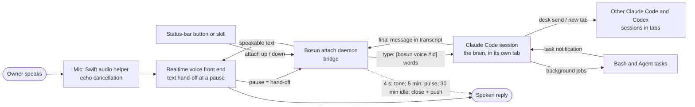

# Voice Ops: Talking To A Desk Of Agent Sessions

<!-- site:summary -->

Bosun is an open-mic voice line into one Claude Code session that is told to do no project work: it
reads every agent session on the desk, relays the owner's words into the one that owns the work, and
opens a new tab for new work. From 2026-10-27 to 2026-11-12 it carried 429 spoken requests over 121
calls on 14 of the 17 days, and a Claude turn took a median 8.8 seconds. This chapter is the recipe:
the brain's prompt, its voice rules, the wiring, a real transcript, what leaves the machine, and
what failed.
<!-- /site:summary -->

## The Pattern

The obvious design for voice and coding agents is a voice assistant that does the work. That is
what Bosun started as: a standalone deck with its own agent brain, a hotkey, and a job ledger. It
was used for nine days in October and then stopped. What replaced it is smaller, and it is the
thing that gets used most days:

- **An open-mic voice call.** No push-to-talk. The owner talks; the voice model waits for the
  pause and hands the words over as one request.
- **A dispatcher brain.** The words land in one ordinary Claude Code session in its own tab, the
  brain. It has a project guide that says, in effect, "you don't do project work here". It reads
  every other agent session in the terminal multiplexer, says where things stand, types the
  owner's words into the session that owns the work, and spawns a new tab when the work is new.
- **Spoken replies from the transcript.** The bridge reads the brain's reply from Claude Code's own
  transcript file, never from the screen, and the voice reads it out. Same rule as
  [supervised delegation](concepts/supervised-delegation.md): the agent's own log is the data
  plane.

The brain is the piece worth copying. Voice is one way to reach it; typing into it works the same.

## How It Works

1. The owner turns voice on from a status-bar button in the multiplexer, or by running the Bosun
   skill inside any Claude Code session. Bosun opens a call with a realtime voice front end that
   hands off text at a pause. The owner's own call runs on a personal, experimental path; the
   supported way to copy this is the metered OpenAI Realtime API.
2. The owner just talks. The voice model listens, waits for the pause, and hands the words to
   Bosun as one request. Fragments split by pauses are stitched into one prompt.
3. Bosun types those words into a real Claude Code session in a terminal tab, tagged
   `[bosun voice #id]`. That session has its normal tools, files, and permissions.
4. If the turn runs past about four seconds, Bosun plays a short tone so the owner knows it is
   working. Long work goes to a background job, so the line stays free.
5. Bosun watches Claude Code's transcript file. When the turn ends, it takes the final message
   (one plain sentence plus up to four short bullets), strips the markdown, and the voice reads it
   out.
6. The usual target is the brain. It does not code; it checks every other session, relays the
   owner's words to the one that owns the work, or opens a new tab for new work, with the owner's
   words and their source in the first prompt
   ([authorization provenance](concepts/authorization-provenance.md)).
7. Words spoken while Claude is busy are kept and sent when it is free. After five quiet minutes
   the brain gives a short desk update. After 25 the voice asks "you still there?", and at 30 the
   call hangs up and sends a phone notification. (The held words, the desk update, the 25-minute
   check-in and the 30-minute idle limit all landed on the last day. Before that, a call closed
   after 3 minutes of quiet and at a 30-minute cap, which is what the 60 idle timeouts and 4 hard
   caps below measured.)
8. If the call itself breaks, only the voice side goes down. In Bosun's source, a broken call is
   logged, a short tone plays, and the bridge reopens the call or says how to; nothing on that
   path touches a Claude session, so the sessions keep working. The window below had no broken
   call, so this is read from the code, not observed.



## The Numbers (2026-10-27 to 2026-11-12)

Counted from Bosun's own event log, through 22:00 UTC on 2026-11-12. Nothing here is a benchmark;
it is one person's desk. The terms mean the same thing everywhere on this page:

- **Call:** one voice connection, from open to hang-up. Connected time counts the whole call,
  quiet stretches included.
- **Hand-off:** the voice model passing Bosun what was said, at a pause.
- **Spoken request:** a hand-off that Bosun typed into a Claude Code session.
- **Refused hand-off:** a hand-off Bosun would not type, and said so aloud.
- **Claude turn:** one prompt in a Claude Code session that Bosun followed to its end, whatever
  started it.
- **Audio restart:** Bosun replacing its audio helper, the small process that runs the mic and
  speaker, after the helper crashed, stalled, or the audio device changed. The call stays
  connected, but a burst of restarts leaves it unusable.

| Measure                         | Value                                                    |
| ------------------------------- | -------------------------------------------------------- |
| Days with voice                 | 14 of 17                                                 |
| Calls                           | 121 (113 opened, 8 failed to open)                       |
| Connected time                  | about 1,000 minutes                                      |
| Call length, opened calls       | median about 5.5 minutes, longest about 71 minutes       |
| Spoken requests                 | 429 (264 to the brain, 165 straight to project sessions) |
| Claude turns                    | 518, of which 491 completed                              |
| Claude turn time, completed     | median 8.8 s, p10 3.5 s, p90 27.5 s                      |
| Completed turns that used tools | 65%                                                      |

Where the 518 Claude turns came from: 433 started from speech (the 429 spoken requests, plus 4
that ended before Bosun typed them), 36 idle-close notices, 24 background-job notifications, 23
prompts sent from Bosun's command line while testing, and 2 quiet-call desk updates. The 8.8
seconds is a whole Claude turn, tool calls included, not speech lag.

How the 121 calls ended, from Bosun's summary record of each call:

| Ending                                                | Calls |
| ----------------------------------------------------- | ----- |
| Idle timeout                                          | 60    |
| Turned off or hung up on purpose (button, CLI, tests) | 46    |
| Failed to open (after a voice-path update)            | 8     |
| Hit the call's hard time cap (30 min then)            | 4     |
| Moved to another session                              | 3     |
| Broke mid-call                                        | 0     |

What failed, plainly:

- **The log mislabeled 36 call endings.** Each call writes two close records. In 36 calls the
  low-level one says "data channel closed", because the channel shut before the deliberate close
  finished. The summary record says why: idle (15), hang-up (12), off (5), CLI (3), or moved (1),
  and each had Bosun's own close request within five seconds of the channel record.
  An early count read those 36 as dropped calls, almost a third. Bosun's own broken-call event
  never fired in the window. Making the low-level record keep the real reason is still open.
- **749 audio restarts, 639 of them in one six-minute crash loop.** On 2026-10-29 the audio
  helper crashed in a loop: 639 restarts in about six minutes across three short calls, which
  were turned off or went idle, plus 5 during the failed opens that morning. The cause was not
  pinned down. On the other days there were 105: 68 after an audio device change and 37 after a
  stall.
- **8 calls never opened.** All 8 were Bosun refusing to open on an update to its voice path that
  it had not yet been checked against.
- **89 refused hand-offs.** By reason: 37 because the target session was busy with work Bosun had
  not sent, 33 because Claude was still on Bosun's previous request, 6 because the multiplexer
  could not tell what the pane was doing, 4 because the multiplexer did not answer in time, 3
  because someone's typing was already in the input box, 3 because Claude was waiting at an
  approval or a question, 2 because the session was not found, and 1 request that was too long.
  Until the last day, the 70 busy cases were said aloud as refusals; Bosun now keeps those words
  and sends them when Claude is free.
- **Turn failures:** of the 518 Claude turns, 8 failed, 6 were interrupted, 6 blocked, 5
  superseded, and 2 abandoned.
- **The hotkey is a dead key.** The README promised a tap-to-talk key. It still targets the
  retired first design, so in daily use it does nothing. The "hotkey fix" pushed in the transcript
  below only stopped that key's rule from swallowing a system window-tiling shortcut; it did not
  bring the key back. Open mic won, and the docs lagged.
- **The first design went unused.** The standalone deck with its own brain and ledger logged 90
  turns over nine days, then nothing. The dispatcher pattern replaced it because it reused the
  sessions already open on the desk instead of running a second agent beside them.

What it was used for: desk status (what each session is doing), relaying decisions into
sessions, starting new sessions, git chores, admin, a design review, and fixing the multiplexer's
own panel. Most voice turns fall between 08:00 and 21:00, peaking mid-afternoon.

## A Real Exchange

Eight consecutive turns from 2026-11-12, about four and a half minutes, in the brain session. The
topic is Bosun itself. The owner's lines are the speech-to-text Bosun handed to Claude, with the
disfluencies and stray punctuation left in. Claude's lines are what the voice read aloud, with the
duration of each Claude turn. Edits are marked: `[...]` is a trim, and other square brackets
replace a private name. Tool calls are summarized; session, pane, and request ids are left out.

**Nathan:** Where's the Bosun voice branch

**Brain** (5.0 s): It only exists on your Mac, in a Codex worktree of the Bosun repo, on a branch
called codex bosun session voice.

- It has never been published to GitHub, which is why its commits cannot be pushed yet.
- It holds the "you still there" check-in, the longer call timings, and my fix for the panel's
  JSON error.
- The Bosun you are talking to right now runs directly from that worktree, so the work is live
  even though it is not backed up.
- Say "publish the Bosun branch" and I will push it to your private Bosun repo and set its
  upstream.

**Nathan:** Yeah, do it

_Tools: git fetch, ls-remote, and log; git push with upstream; the owner's task list marks one
item done._

**Brain** (19.5 s): Done, the Bosun voice branch is now published to your private Bosun repo and
tracking it.

- Four commits went up: the tone acknowledgements, the hotkey fix, the "you still there"
  check-in, and the panel JSON fix.
- I ticked that item off your open list.
- The [...] fix in that worktree is still uncommitted, because it is tangled with older
  background session work that needs your call.
- Nothing was merged into Bosun's main branch; this only backed the branch up.

**Nathan:** Probably private, huh ? Unless it's , just let me know what you think And what is that

**Brain** (7.5 s): Yes, it is private, I checked, and I would keep it that way since it holds your
personal voice setup; and "that" is the fix that lets Bosun find sessions [...].

- [...]
- The fix [...] is already live and passed the full test run.
- It is uncommitted because it touches the same file as some unfinished background session work
  from early November that was never committed either.
- I think it should be committed together with that older work [...]; say yes and I will have the
  Bosun session do it.

**Nathan:** What was the background session work

_Tools: git status, diff stat, and the diff of one attach source file._

**Brain** (11.5 s): It lets Bosun recognise Claude background sessions, the kind where your
terminal is only a thin window onto a session running in the background.

- When a tab is running "claude attach" to a background job, Bosun used to see no session there
  at all.
- The early November work makes Bosun look up which background session that tab is showing, so
  voice can attach to it like any other.
- It also guards against stale records and reused process numbers, and it comes with a large set
  of tests.
- It was never committed, and the [...] fix was later written on top of the same file,
  which is why the two are tangled.

The Bosun session is also editing that worktree right now for the periodic check feature, so I
would let it commit all three together when it finishes.

**Nathan:** [...] Explain it to me. [...] Well, so , Is there already something that has - Like,
how is it working today? Say that again, what was it for? What did it do

**Brain** (6.3 s): It is about one thing: letting you talk to a Claude session that runs in the
background, and it is already working today because Bosun runs that uncommitted code.

- Normally Claude runs right inside the tab, and Bosun finds it by looking at what program that
  tab is running.
- A background session is different: the real Claude runs out of sight, and the tab only shows a
  viewer onto it.
- Before this work, Bosun looked at such a tab, saw only the viewer, and concluded there was no
  session to attach your voice to.
- The work taught Bosun to follow the viewer back to the real session behind it, so voice
  attaches there just the same.

So nothing is broken or missing right now; the only loose end is that this code lives on your Mac
without being saved in a commit.

**Nathan:** So it's already working how I had wanted it to, right

**Brain** (4.8 s): Yes, as far as the code and its tests show, though I have not watched it attach
to a real background session myself.

- The code is live in the Bosun you are using, and its tests passed in the last full run.
- The sessions you have open today are all ordinary ones, so the background path has not been
  exercised in front of me.
- If you want certainty, start one background session and say "attach to it", and we will see it
  work or fail in about a minute.

**Nathan:** Oh, so I could just tell it to like teleport over there . What use would that be
anyways

**Brain** (5.5 s): Yes, you could move Bosun's voice onto that session, but honestly the use is
modest for how you work now.

- It would let you talk directly to one long-running background job, hearing its answers
  first-hand instead of through me.
- That helps when a single session needs a real back-and-forth, like the [one design session]
  where you are giving detailed feedback.
- For everything else, staying on the brain is better, because I can see every session and relay
  to any of them.
- So it is a nice-to-have that already works, not something you need to act on.

**Nathan:** So that was just a change to be able to tell voice to do that because I can already
do that if I just go to the session and attach . If I just say, hey, summon Bosun and this other
place

**Brain** (5.3 s): Not quite: summoning Bosun from a session already worked, and this change only
makes that same summon work when the session is a background one.

- In an ordinary session, running the Bosun command there has always attached voice to it.
- In a tab that is just a viewer onto a background session, that same command used to fail
  because Bosun could not find a session behind the viewer.
- The change fixes that case, so summoning works the same in both kinds of tab.
- It did not add a new voice command; it removed a blind spot.

What to notice, good and bad. The owner never named a file, a pane, or a command. This excerpt has
no relay; the brain answered from what it read and did the one chore itself. The two mutations (a
push that set an upstream, and ticking an item off the owner's task list) happened on "Yeah, do it"
after the brain offered the push; the tick was not asked for. The brain ran both itself rather than
relaying, which bends its own "no project work" rule: the rule is a prompt, not a wall. Once, the
brain said what it had not verified ("I have not watched it attach") instead of rounding up. Two
replies, the fourth and fifth, ran a paragraph past the bullets the voice rules ask for.

This is the raw shape of a stitched request as it reaches the brain, from the seventh turn:

```text
[bosun voice #id] Voice transcript leading up to this request (pauses may split one instruction):
Oh, so I could just tell it to like teleport over there . What use would that be anyways

Use that context to understand the complete request; earlier conversation is not a new command.
Latest voice fragment:
. What use would that be anyways
```

## Copy This

You need Claude Code and a terminal multiplexer. Voice is optional for the first hour.

1. **Make the brain's folder.** An empty directory with
   [`templates/bosun-brain/CLAUDE.md`](../templates/bosun-brain/CLAUDE.md) as its project guide.
   The guide is short on purpose: see, act, authority, speaking. Nothing about any project.
2. **Write the `desk` wrapper.** A small script over your multiplexer with the verbs below. Put
   the safety rules in the wrapper: it never closes the brain or the session voice is on, and it
   refuses to close a working session without an explicit flag.
3. **Allowlist the read verbs and `desk away`.** In the brain folder's `.claude/settings.json`,
   allow `desk`, `desk last`, `desk read`, `desk search`, `desk focus`, and `desk away`, so looking
   and tidying never stall a call on a permission prompt. Leave `desk send`, `desk new`, and
   `desk close` on Claude Code's prompt, which means confirming at the keyboard. The guide adds its
   own rule on top: the brain sends only when the owner named the session and what to tell it, and
   closes only after reading the list back and hearing a yes. The owner's own desk allowlists the
   whole wrapper so a call never waits on a prompt; that leaves the wrapper's refusals and the
   guide's rules as the only guard, so widen it only once the refusals have held for you.
4. **Start it with the voice rules.** Run
   `claude --name "Voice brain" --append-system-prompt-file voice-rules.md` in that folder, with
   [`templates/bosun-brain/voice-rules.md`](../templates/bosun-brain/voice-rules.md) beside it.
   The rules keep replies speakable (one sentence, up to four bullets) and push anything over
   about fifteen seconds into a background job so the line stays free.
5. **Try it by typing.** Type `[voice #1] what's on the desk?` into the brain. Then
   `[voice #2] tell the api session to rerun its tests`. If the replies read well aloud and the
   relay lands in the right tab, the pattern works before any audio is involved.
6. **Add a voice bridge.** Any realtime voice front end that hands off text at a pause will do; the
   OpenAI Realtime API is the supported choice. The bridge types the tagged words into the brain's
   tab, reads the reply from Claude Code's transcript file (not the screen), strips the markdown,
   and speaks it. Keep words that arrive while the brain is busy and send them when it frees up.

The `desk` verbs, with the commands they wrap:

| Verb                   | Must do                                                                                           | Herdr                           | tmux                                                     |
| ---------------------- | ------------------------------------------------------------------------------------------------- | ------------------------------- | -------------------------------------------------------- |
| `desk`                 | list sessions with state: working, needs you, idle                                                | `herdr-app ls`, `hc ls --json`  | `tmux list-panes -a -F ...`                              |
| `desk last <t>`        | last prompt and last reply, read from the agent's transcript                                      | match the tab to its transcript | match the pane to its transcript                         |
| `desk read <t>`        | the visible screen                                                                                | `hc read <t>`                   | `tmux capture-pane -p -t <t>`                            |
| `desk search <words>`  | search every Claude Code and Codex transcript on disk                                             | plain file search               | plain file search                                        |
| `desk focus <t>`       | bring the tab to the front                                                                        | `herdr-app do agent.focus`      | `tmux select-window -t <t>`                              |
| `desk send <t> <text>` | type, press enter; refuse if someone is typing or the agent is waiting at an approval or question | `hc send <t> <text>`            | `tmux send-keys -t <t> -l '<text>'`, then `Enter`        |
| `desk away <t>`        | hide the tab from lists; it keeps running                                                         | the app's hide/away action      | `tmux break-pane -d -s <t>`, or a session you don't list |
| `desk close <t>`       | close the tab; the conversation stays resumable                                                   | the app's close action          | `tmux kill-pane -t <t>`                                  |
| `desk new`             | open a tab in a folder running an agent with a first prompt                                       | `herdr-app do tab.new`          | `tmux new-window -c <dir> ...`                           |

## What Leaves The Machine

- **To the voice provider** (OpenAI here): the microphone audio for the whole call, quiet
  stretches and anything else the mic picks up included; a one-line status naming the attached
  session and its project; the last few lines of conversation when a call reopens;
  and every reply the voice reads aloud. Replies summarize other sessions, so desk status reaches
  the voice provider in spoken form.
- **To the brain's model provider** (Anthropic, as for any Claude Code session): the transcribed
  words, plus whatever the brain reads with `desk`. Other sessions' last prompts and replies, their
  screens, and transcript search hits come back as tool output, and a screen that shows a secret
  is sent like any other tool output.
- **To the other sessions' providers:** the words relayed into them, as an ordinary prompt.
- **To the owner's phone:** one short notification when a call closes on idle, sent through
  Claude Code's push notifications.
- **Stays on the machine:** Bosun's event log, which keeps the text of every request, and the
  session transcripts it reads.

## Threat Model

Voice reaches a shell. Every spoken request becomes a prompt in a Claude Code session running
with that session's normal permissions, so what a mishearing or a nearby voice can do is bounded
by those permissions, not by anything voice-specific. While a call is open the mic hands off what
it hears, so mute or hang up when someone else is talking. Bosun types only into a Claude that is
idle, never over someone's typing, and never into a pane waiting at an approval or a question, so
voice cannot answer a permission prompt; that happens at the keyboard. The brain may look, focus,
and put tabs away on its own, and relays when the owner named the session and the words. A guessed
target needs a read-back and a yes; a change to shared state (a push, a merge, a deploy, a message
to a person) needs the owner's words for that action, or a yes to the brain's offer of it; a close
needs a dry run read back and a yes, and closing a working session also needs a flag the wrapper
checks. Those are prompt rules plus wrapper refusals, not a sandbox: a project session with a broad
allowlist will act on a relayed mishearing, so keep risky commands on Claude Code's prompt there.
The brain reads other sessions' screens and transcripts, which can carry text from the web or
tools; treat that as untrusted, since the brain can type into every pane.

## What Is Third-Party, And What Is Personal

- **Third-party tools.** [Herdr](https://herdr.dev) is the terminal multiplexer (`herdr-app`
  places tabs, `hc` reads and types into terminals). Claude Code is the brain and the project
  sessions. Codex is a second agent on the desk. OpenAI provides the realtime voice. None of them
  is affiliated with this repo.
- **The voice transport.** The supported way to copy this is the metered OpenAI Realtime API, or
  any realtime voice front end that hands off text at a pause. The owner's own call runs on a
  personal, experimental path that has broken between releases; this chapter does not document it
  or recommend building on it.
- **Bosun itself** (the bridge, the audio helper, the status-bar button) is the owner's own code.

## Status

Bosun's source is private for now. The recipe above (the brain's guide, its voice rules, the
wiring, and the numbers) is the copyable part, and it does not depend on Bosun's code. A public
source preview is planned once the attach bridge has a provider seam for the OpenAI Realtime API,
so a stranger can run it with their own key.
